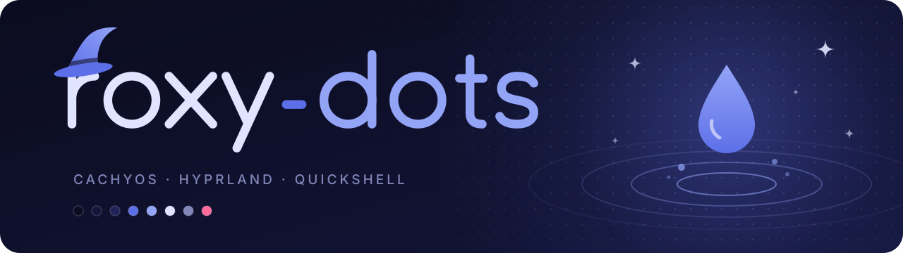

<p align="center">
  
</p>

My personal dotfiles for **CachyOS + Hyprland + Quickshell**.
Dark blue-violet, TUI look, custom shell, everything built by hand.

> Status: 🚧 work in progress. The setup is being built step by step.

## Overview

| Area | Tool |
|---|---|
| Distro | CachyOS (AMD, open-source drivers) |
| Compositor | Hyprland |
| Shell (bar, OSD, popups, launcher, lockscreen) | Quickshell (QML) |
| Wallpaper | linux-wallpaperengine / mpvpaper |
| Audio interface | GoXLR via `goxlr-utility` |
| Discord | Vesktop (Vencord), TUI theme built on system24 |
| Spotify | Spicetify, TUI theme |
| Terminal | Ghostty |
| Terminal shell | fish + Starship |
| System info | fastfetch with your own image as ASCII logo |
| Boot menu | GRUB theme, terminal style (`roxy grub`) |
| Dotfile management | GNU Stow via the `roxy` CLI |

## Planned features

- [ ] Custom top bar (workspaces, clock, volume, tray)
- [ ] Spotify popup on song change (MPRIS), fading in at the top left, with playback controls
- [ ] OSD module for GoXLR faders, mic mute, system volume and brightness
- [ ] Custom notifications
- [ ] Custom launcher
- [ ] Lockscreen
- [ ] Wallpaper Engine as background
- [ ] Infinite-canvas workflow
- [ ] Vencord theme generated from the same color palette (based on system24 theme)
- [ ] Spotify theme (Spicetify), TUI style: labeled frames (lib, home, queue, player), square covers, `[ ⏸ ]` play button
- [ ] Ghostty, fish, Starship and fastfetch in the Periwinkle palette
- [ ] GRUB theme (ASCII art section planned for later)
- [ ] Hotkey overlay (holding Super highlights bound keys), later on keyboard LEDs
- [ ] Multi-theme switcher

## Theme: Periwinkle

A dark blue-violet palette. All colors come from a single source (`themes/roxy.json`) and are distributed by script
to Hyprland, terminal, GTK/Qt, Quickshell, Vencord and Spotify.
Until that script exists, the values are copied into each config by hand.

| Role | Hex |
|---|---|
| bg | `#0b0c1f` |
| surface | `#13153a` |
| surface2 | `#1e2256` |
| shadow | `#3f4bb8` |
| primary | `#5d6fe8` |
| secondary | `#93a4f7` |
| violet | `#a48cf2` |
| text | `#e1e4ff` |
| muted | `#8086b8` |
| frame | `#545b96` |
| danger | `#ff6b9a` |

Additional themes can be added later as extra JSON files.

## Structure

```
roxy-dots/
├── hypr/              # Hyprland config
├── quickshell/
│   ├── shell.qml      # Entry point
│   ├── Theme.qml      # Singleton: colors and animation timings
│   ├── bar/           # Top bar
│   ├── osd/           # Overlays (GoXLR, mute, volume)
│   ├── media/         # Spotify popup (MPRIS)
│   ├── notifications/ # Notification daemon
│   ├── launcher/      # App launcher
│   └── lockscreen/
├── roxy               # CLI: install, remove, update, status
├── ghostty/           # Terminal config + Roxy color theme
├── fish/              # conf.d/roxy.fish: syntax colors, Starship, fastfetch greeting
├── starship/          # TUI frame prompt with git and language segments
├── fastfetch/         # System info, logo from assets/roxy.png
├── spicetify/         # Spotify theme (color.ini + user.css)
├── themes/            # Color palettes (roxy.json, ...)
├── scripts/           # Theme generator and helpers
├── vencord/           # Vesktop theme (system24 + Periwinkle palette)
├── grub/roxy/         # GRUB theme, copied to /boot by `roxy grub`
├── assets/            # Characters, wallpapers per theme
├── PLAN.md
└── README.md
```

## Installation

```bash
git clone git@github.com:vxnsin/roxy-dots.git ~/roxy-dots
~/roxy-dots/roxy install
```

`roxy install` installs the missing packages (through `paru`/`yay`), moves existing
configs to `~/.local/state/roxy-dots/backup/`, links the configs with GNU Stow, applies
the Spotify theme and puts `roxy` into `~/.local/bin`.

```bash
roxy status                 # what is linked, what is missing
roxy install starship fish  # only some packages
roxy install --dry-run      # show what would happen
roxy update                 # git pull, backup, relink, re-apply app themes
roxy update spicetify       # after a Spotify update wiped the theme
roxy remove spicetify       # unlink a package
roxy backup                 # snapshot configs and app settings
roxy restore                # list backups
roxy restore latest         # put the newest one back
roxy grub                   # theme the GRUB boot menu (sudo)
roxy grub remove            # switch it off again
```

`roxy grub` only works when the system boots with GRUB (`/boot/grub/grub.cfg` exists;
the CachyOS installer also offers systemd-boot and Limine). It builds the fonts from
JetBrains Mono, copies the theme to `/boot/grub/themes/roxy`, sets `GRUB_THEME` in
`/etc/default/grub` (the original is saved once to `~/.local/state/roxy-dots/`) and
rebuilds `grub.cfg`. `roxy update` refreshes an installed GRUB theme too.

Backups live in `~/.local/state/roxy-dots/backup/` (one folder per snapshot, named by date
and reason). `install` moves conflicting configs there, `update` and `restore` take a
snapshot before they change anything. `update` also updates the `roxy` CLI itself.

Packages: `ghostty`, `fish`, `starship`, `fastfetch`, `spicetify`, `vencord`.
Each package folder mirrors the home directory (`ghostty/.config/ghostty/...`).

Manual steps:

- **fastfetch logo:** put any PNG at `assets/roxy.png`; fastfetch renders it as ASCII art.
- **Spotify:** install and open Spotify once before `roxy install spicetify`.
- **Vesktop:** start it once, then close it before `roxy install vencord` so the theme can be
  switched on automatically (otherwise: Settings → Themes → Roxy).
- **Font:** JetBrains Mono everywhere (TUI look); `roxy` installs `ttf-jetbrains-mono`.

Not covered by `roxy` yet: `quickshell`, `hyprland`, `goxlr-utility`.

## Note on assets

Character artwork and wallpapers are not part of this repo unless I made them myself.
The `assets/` folder is therefore listed in `.gitignore`.

## Inspiration

- [caelestia-dots](https://github.com/caelestia-dots) (soramane)
- [dots-hyprland](https://github.com/end-4/dots-hyprland) (end_4)
- [system24](https://github.com/refact0r/system24) (refact0r, MIT), base of the Vencord theme
- [quickshell.org](https://quickshell.org)

## License

To be decided.
