<p align="center">
  
</p>

A desktop for CachyOS and Hyprland that looks like a terminal: square frames, one
monospace font and the same colors in every app. It started as my dotfiles and grew
into its own shell.

<p align="center">
  
</p>

## What's in it

- A Quickshell shell: bar, control center with GoXLR faders and an app mixer, launcher,
  lockscreen, notifications, OSD and a wallpaper app
- Tiling with workspaces, or an infinite canvas where windows float on an endless plane
- A launcher that does more than apps: Spotify, Discord DMs, timers and alarms,
  emoji, files, ssh, clipboard, web search and Claude
- Bridges to Discord (calls, voice joins, messages), the GoXLR and Spotify
- Six themes for Ghostty, fish, Starship, Spotify, Vesktop, Zed, Dolphin, Zen and GRUB
- `frame`, one command to install, update and switch themes

## Install

```bash
git clone https://github.com/vxnsin/frameshell ~/frameshell
~/frameshell/frame install
```

It asks whether you want everything or pick the apps, which layout and which theme; a
connected GoXLR gets its utility on its own.

<p align="center">
  
</p>

## Using it

| Key | |
|---|---|
| Super+Space | launcher |
| Super+C | control center |
| Super+W | wallpapers |
| Super+L | lock |
| Super+E, Super+B, Super+Shift+E | Dolphin, Zen, Zed |
| hold Super | all hotkeys on a keyboard map |

```bash
frame theme set sakura   # periwinkle, sakura, matcha, ember, lagoon, mono
frame update             # pull and apply everything again
frame status             # what is linked and what is missing
```

The details are in [docs](docs/): [the shell](docs/shell.md), [Spotify](docs/spotify.md), [themes](docs/themes.md)
and [the frame command](docs/frame.md).

> Work in progress. Everything above is built, but none of it has run on Linux yet;
> that is the next step. After that: Steam through Millennium.

Thanks to [system24](https://github.com/refact0r/system24) (the base of the Vesktop
theme), [caelestia](https://github.com/caelestia-dots), [end-4's dots-hyprland](https://github.com/end-4/dots-hyprland)
and [Quickshell](https://quickshell.org).
